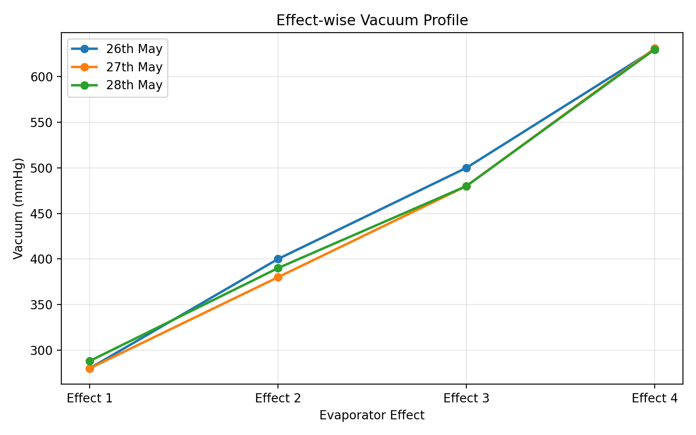
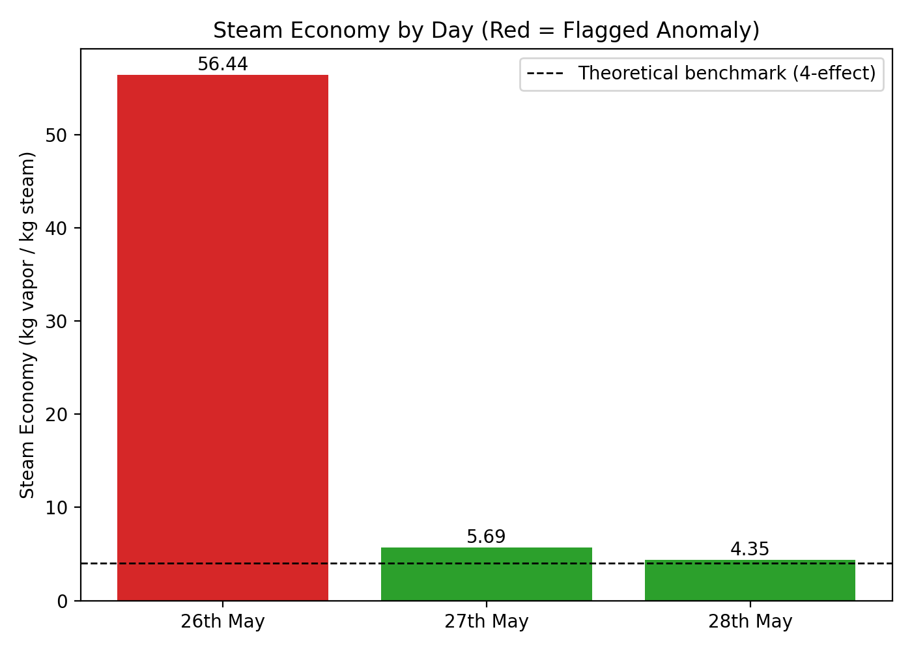

# Lupin MEE Energy & Steam Efficiency Analysis

This project looks at operating data from a four-effect Multiple Effect Evaporator (MEE) system and uses Python and SQL to calculate process KPIs, review operating trends and flag readings that may need an instrumentation check.

The data was collected during a process engineering internship in May 2026. The repository contains a small shift-log dataset, so the results are an analysis of the available readings rather than a long-term performance study.

## What I looked at

- Steam economy and evaporation load
- Feed-to-product concentration factor
- Condensate recovery ratio
- Cooling-water temperature rise
- Effect-wise vacuum profile
- Unusual steam-flow readings

## What stood out

One steam-flow reading (132 kg/hr) is far below the other two readings (1,318–1,700 kg/hr). Using it without checking would produce an implausibly high steam-economy value. The cleaning script flags readings outside the 1–10 range for review rather than treating them as normal operating data.

For the two readings not flagged by this rule, the average steam economy is approximately 5.0 kg vapor per kg steam. The third day's value is about 4.35. These figures should be interpreted cautiously: there are only three days of readings, and the benchmark used in the analysis is a reference for a four-effect system, not a guarantee of actual plant performance.

## Charts

**Effect-wise vacuum profile**



**Steam economy by day**



**Feed and product concentration**


## Files

- `LUPIN_DATASET_original.xlsx` — original shift-log readings
- `01_data_cleaning.py` — loads the readings, converts numeric fields and flags unusual steam-economy values
- `02_kpi_calculations.py` — calculates process KPIs and exports `kpi_summary.csv`
- `03_vacuum_profile_chart.py`, `04_steam_economy_chart.py`, `05_concentration_trend_chart.py` — create the charts shown above
- `cleaned_mee_data.csv` and `kpi_summary.csv` — processed data and calculated KPIs
- `mee_analysis.sql` — SQL queries for reviewing the readings and calculated metrics
- `mee_database.db` — SQLite database

## Run

Install the dependencies:

```bash
pip install -r requirements.txt
```

Run the scripts from the repository's main directory, in this order:

```bash
python 01_data_cleaning.py
python 02_kpi_calculations.py
python 03_vacuum_profile_chart.py
python 04_steam_economy_chart.py
python 05_concentration_trend_chart.py
```

The scripts read and write files in the repository's main directory. The SQL queries can be run against `mee_database.db` using SQLite.

## Notes

The anomaly flag is a screening rule, not proof that an instrument is faulty. A flagged value needs to be checked against the original log and plant records. The dataset is limited, so the findings should not be generalised beyond the readings analysed.
