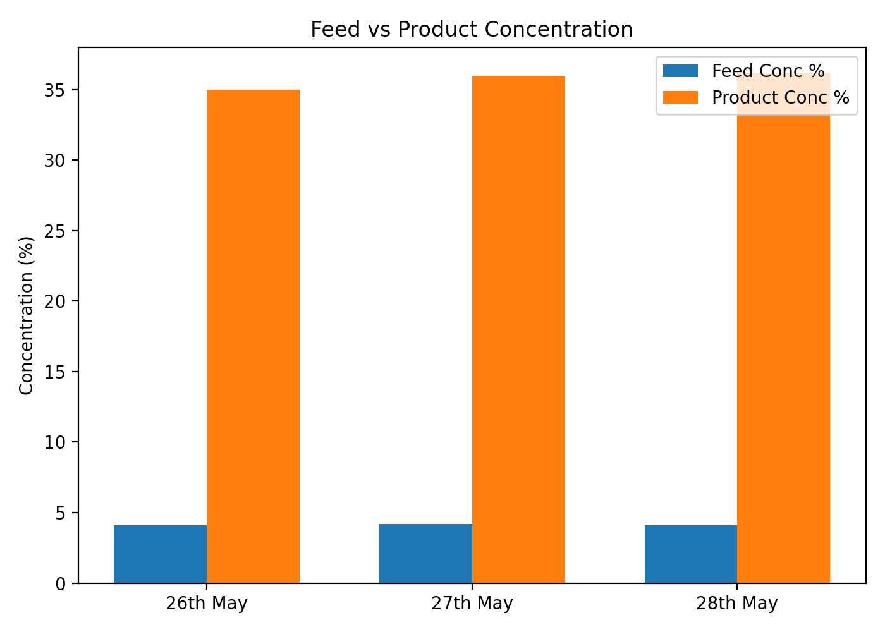

# Lupin MEE Energy & Steam Efficiency Analysis

This project looks at operating readings from a four-effect Multiple Effect Evaporator (MEE) and uses Python and SQL to calculate process KPIs and flag readings that need a closer check.

The data was collected during a process engineering internship at Lupin Pharmaceuticals, Bhopal, in May 2026. It covers three operating days.

## What I analysed

- Cleaned the shift readings and flagged a steam-flow value that produced an implausible steam-economy result.
- Calculated evaporation load, steam economy, concentration factor, condensate recovery ratio and cooling-water temperature rise.
- Queried the readings in SQLite and plotted the vacuum profile, steam economy and feed-to-product concentration.

One reading showed a steam flow of 132 kg/hr, compared with 1,318–1,700 kg/hr on the other two days. I treated the resulting steam-economy value as an instrumentation or logging issue to investigate, rather than using it uncritically in the average. The reliable readings give an average steam economy of about 5.0 kg vapor/kg steam.

These are observations from a small, three-day dataset, not a long-term performance assessment of the plant.

## Charts

**Effect-wise vacuum profile**

**Steam economy by day**

**Feed and product concentration**

## Files

The files are kept in the repository root:

- `01_data_cleaning.py` — reads the raw Excel file, cleans the readings and flags anomalies.
- `02_kpi_calculations.py` — calculates the process KPIs and writes `kpi_summary.csv`.
- `03_vacuum_profile_chart.py`, `04_steam_economy_chart.py`, `05_concentration_trend_chart.py` — create the charts shown above.
- `LUPIN_DATASET_original.xlsx` — raw shift-log data.
- `cleaned_mee_data.csv`, `kpi_summary.csv` — cleaned readings and calculated KPIs.
- `mee_analysis.sql`, `mee_database.db` — SQL queries and SQLite database.
- `vacuum_profile.png`, `steam_economy.png`, `concentration_trend.png` — chart outputs.

## Tools

Python, pandas, NumPy, matplotlib and SQLite.

The dataset contains a small number of manually logged plant readings. Share it only if you have permission to disclose the underlying internship data.
